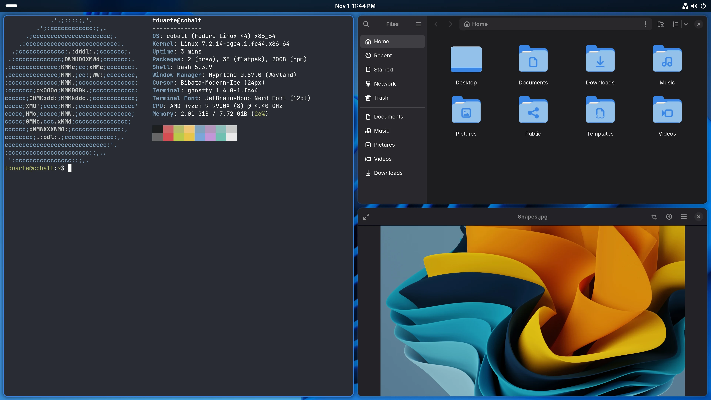
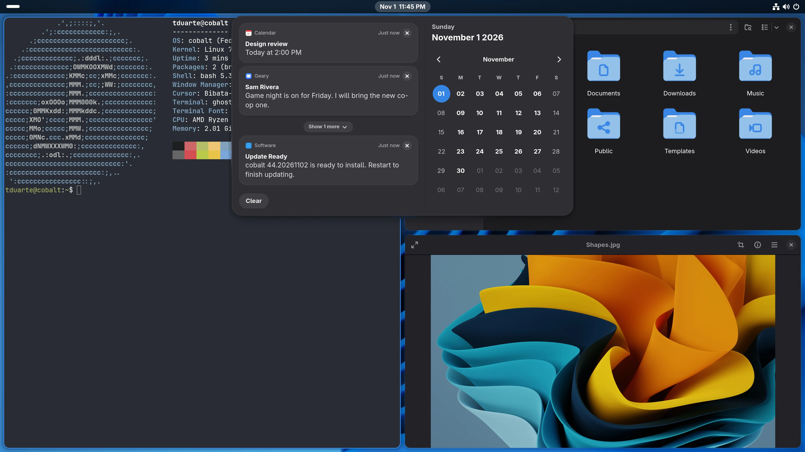
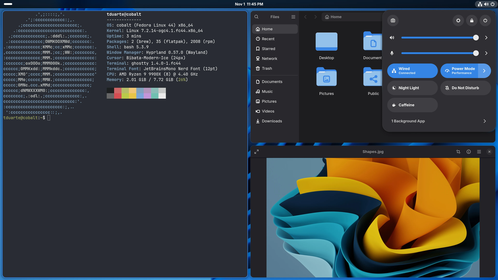
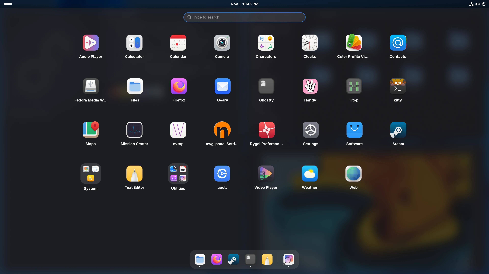
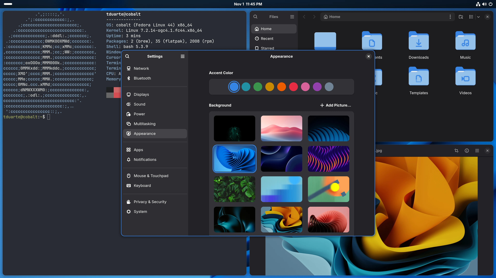
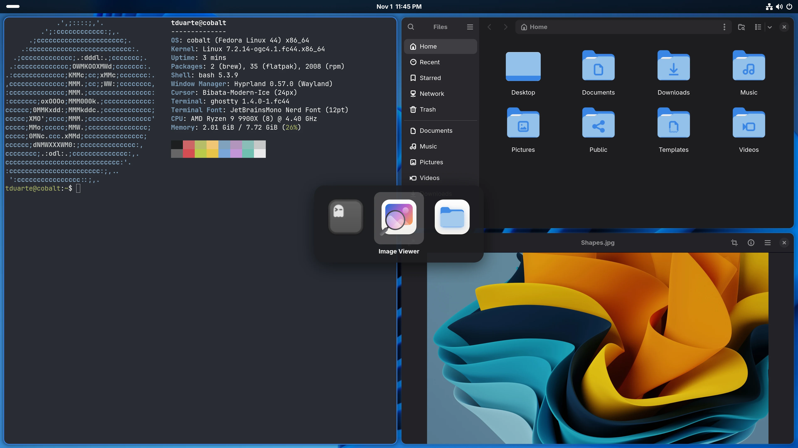
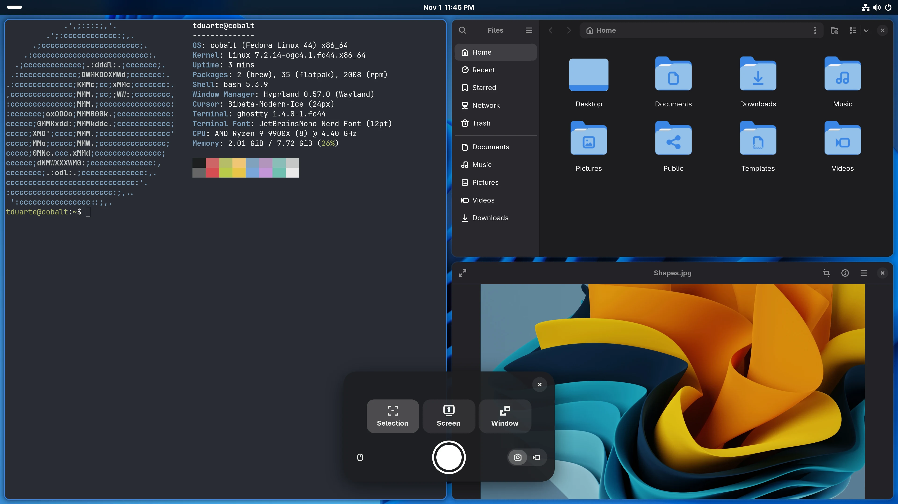
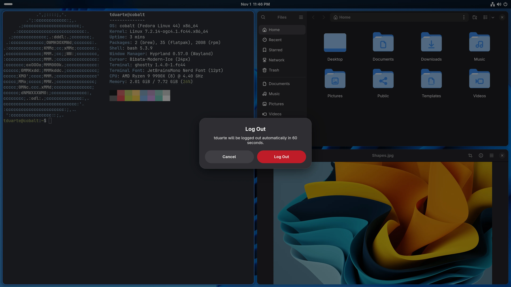
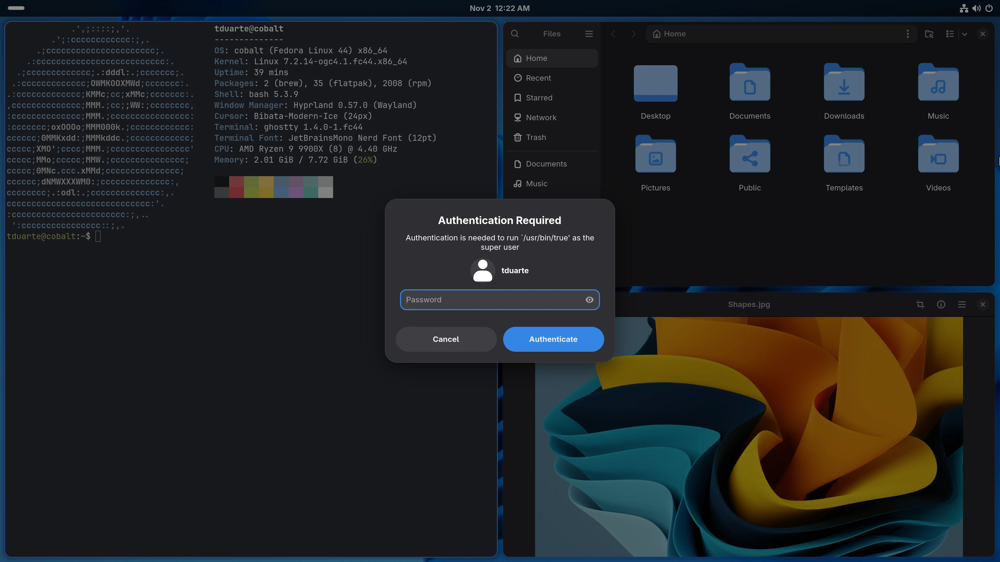
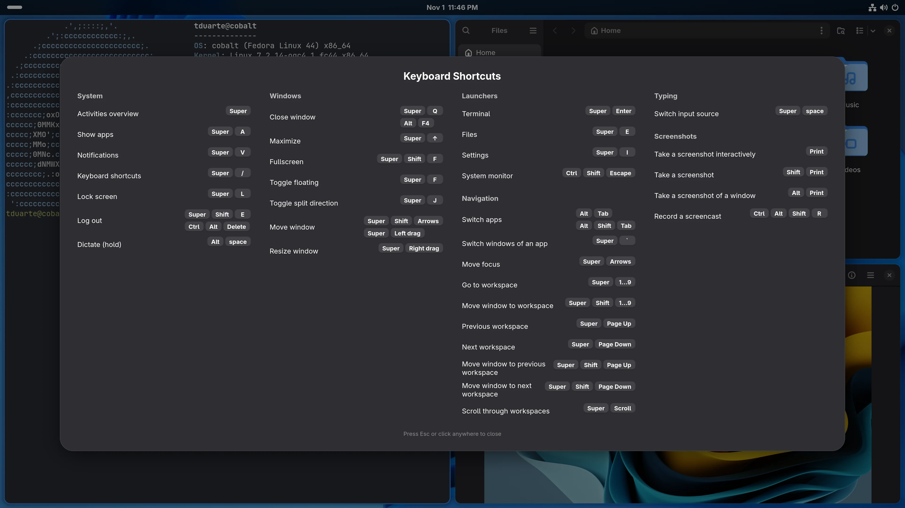

# cobalt

**The GNOME experience with Hyprland's tiling and personalization.**

cobalt is a [bootc](https://github.com/bootc-dev/bootc) image built on
[Universal Blue](https://universal-blue.org)'s desktop-less `base-main`, with
[Bazzite](https://bazzite.gg)'s gaming stack and
[Hyprland](https://hyprland.org) as the compositor. On top sits a GNOME-style
shell and our own libadwaita Settings app, so it looks and behaves like GNOME
while windows tile like Hyprland.



> [!NOTE]
> cobalt is a personal image, built to replace Bazzite on one gaming and
> development PC (Ryzen 9 9900X, Radeon RX 9070, Secure Boot). It's usable
> and in active development; expect rough edges on other hardware.

## Reuse GNOME first

GNOME is three layers, and only the last one is tied to GNOME Shell and
Mutter:

1. **Apps** (Files, Calendar, Weather, Text Editor…) are used as they are.
2. **Services and settings** (GSettings keys, portals, gnome-keyring,
   NetworkManager, UPower, power-profiles-daemon, Evolution Data Server…) are
   used as they are. Our Settings app writes GNOME's own keys, so libadwaita
   apps follow it exactly as they would on GNOME.
3. **The shell layer** (top bar, notifications, quick settings, launcher, lock
   screen, display and input configuration) is the only part cobalt rebuilds:
   an [AGS](https://github.com/Aylur/ags) shell and a few small session
   daemons that follow GNOME's keys and behavior on top of Hyprland.

The full reasoning, decisions and milestones are in
[docs/BRIEF.md](docs/BRIEF.md).

## Screenshots

| | |
|---|---|
|  |  |
| **Date menu:** notifications grouped by app, calendar, events, world clocks, weather | **Quick settings:** sound, network, power mode, Night Light, Do Not Disturb |
|  |  |
| **Launcher:** search, GNOME's app grid and folders, dash | **Settings:** a libadwaita app with GNOME Settings' pages |
|  |  |
| **Alt+Tab:** apps in recently used order | **Screenshot UI:** selection, screen or window; screenshot or screencast |
|  |  |
| **End session:** apps close first, nothing unsaved is lost | **Password prompts:** admin (polkit), Wi-Fi and VPN passwords |


**Keyboard shortcuts** (Super+/), generated from the live config

## What's in it

**Shell** (AGS v3 / GTK 4, `shell/`)
- GNOME-style top bar: activities, workspaces, clock, status icons, privacy
  indicators (microphone, screen sharing, recording).
- Quick settings with inline menus: Wi-Fi, wired, VPN, Bluetooth, sound
  devices, power mode, Night Light, Do Not Disturb, Caffeine, background apps.
- Date menu with media players, notifications grouped by app, a calendar,
  the selected day's events (Evolution Data Server, through GNOME Shell's
  calendar server), world clocks (GNOME Clocks) and the weather (GNOME
  Weather's location).
- Launcher with search, GNOME's app grid and folders, and the dash
  (favorites and running apps); also on the bottom Hot Edge.
- Alt+Tab app switcher, Log Out / Restart / Power Off dialog, screenshot and
  screencast UI, keyboard shortcut sheet, update notifications.
- GNOME's password prompts: the polkit agent ("Authentication Required")
  and NetworkManager's secret agent (Wi-Fi, 802.1X, VPN passwords).

**Settings** (libadwaita, `settings/`)
- Wi-Fi, Network (wired, VPN, proxy), Bluetooth, Displays (resolution,
  refresh rate, VRR, HDR, scale, Night Light), Sound, Power, Multitasking,
  Appearance (accent color, backgrounds), Apps, Notifications, Mouse &
  Touchpad, Keyboard (layouts and editable shortcuts), Privacy & Security,
  and System (region, date and time, users, SSH, about).
- Dark only. Changes apply live to Hyprland and are saved to files the
  Hyprland config loads.

**Session**
- GDM login, Hyprland 0.57 with a Lua config (`system_files/usr/share/cobalt/hypr/`).
- hyprlock, hypridle, hyprpaper and hyprsunset, driven by GNOME's settings.
- GNOME's portal for file chooser and other dialogs; Hyprland's portal for
  screen sharing, with a libadwaita share picker.
- SwayOSD for volume and brightness, gnome-keyring with its SSH agent,
  GNOME Software for Flatpaks and OS updates.

**Gaming and base** (from Bazzite and Universal Blue)
- Universal Blue's signed OGC kernel, Valve-patched Mesa, Steam, gamescope,
  MangoHud, sched_ext schedulers, ROCm.
- VRR and tearing for fullscreen games; no banners over fullscreen windows.
- ghostty, distrobox, podman and Homebrew.

## Install

> [!WARNING]
> Switching changes your whole OS image. Your current deployment stays
> available in the boot menu, and `sudo bootc rollback` goes back to it.

From any bootc-based system (Bazzite, Bluefin, Aurora, Fedora Atomic):

```bash
sudo bootc switch ghcr.io/tduarte/cobalt:latest
```

Then reboot. Images are signed; to check the signature:

```bash
cosign verify --key cosign.pub ghcr.io/tduarte/cobalt:latest
```

The kernel and its modules come from Universal Blue's signed builds. If you
use Secure Boot and come from a Universal Blue image, their key is already
enrolled.

## Building

The image builds with `just` and podman:

```bash
just build cobalt latest
```

CI (`.github/workflows/build.yml`) builds, rechunks and signs
`ghcr.io/tduarte/cobalt` on every push to `main` and nightly.

Development happens in a GNOME Boxes VM fed from a local registry
(`just vm-push`, `just vm-update`), and the shell and Settings app can run
straight from the checkout inside it (`just shell-dev`,
`just settings-dev`). [AGENTS.md](AGENTS.md) has the full workflow and the
lessons learned along the way.

| Path | What |
|---|---|
| `Containerfile`, `build_files/` | The image, one build step per script |
| `system_files/` | Configs, scripts and units copied into the image |
| `shell/` | The AGS shell |
| `settings/` | The Settings app |
| `docs/BRIEF.md` | Goals, decisions and milestones |

## Credits

- [Universal Blue](https://universal-blue.org) and
  [Bazzite](https://bazzite.gg) for the base image, kernel and gaming stack.
- [Hyprland](https://hyprland.org) and its tools.
- [Aylur's GTK Shell](https://github.com/Aylur/ags) and Astal.
- [GNOME](https://www.gnome.org) for the apps, services and design this
  image follows.
- [SwayOSD](https://github.com/ErikReider/SwayOSD),
  [gpu-screen-recorder](https://git.dec05eba.com/gpu-screen-recorder/about/),
  [Adwair](https://github.com/kusaida/Adwair) icons and
  [Bibata](https://github.com/ful1e5/Bibata_Cursor) cursors.
- Wallpapers from Unsplash; see
  [their credits](system_files/usr/share/backgrounds/cobalt/CREDITS.md).

Licensed under the [Apache License 2.0](LICENSE).
